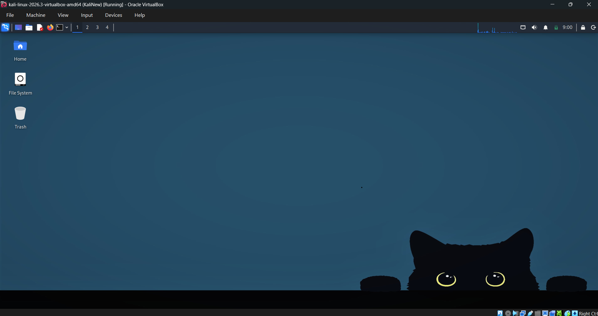
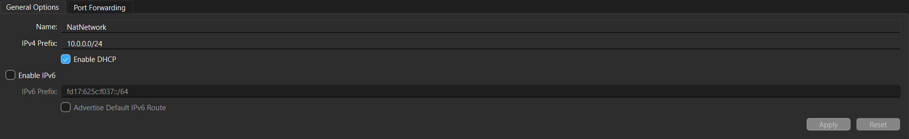
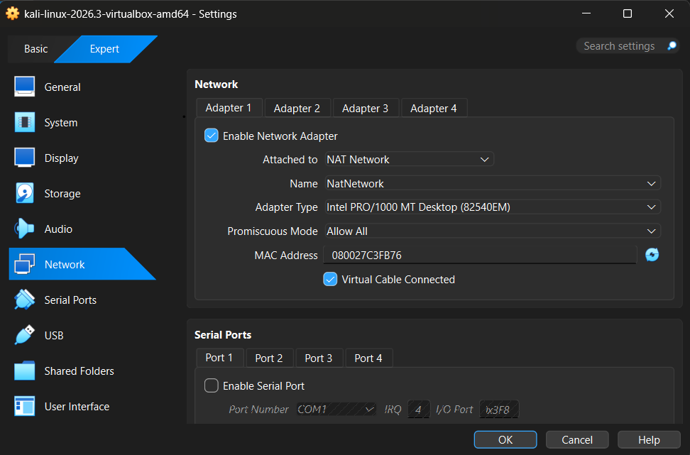
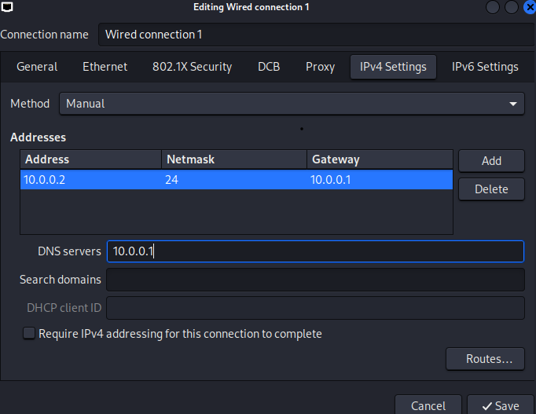
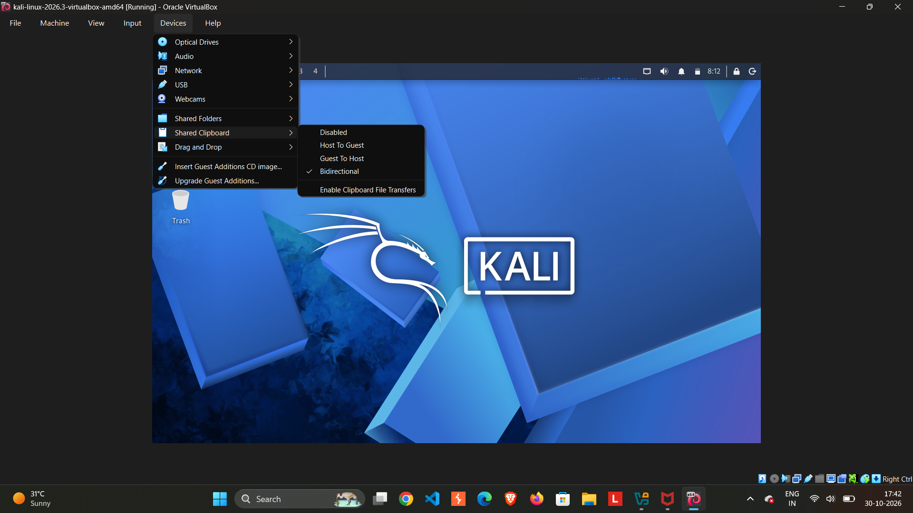
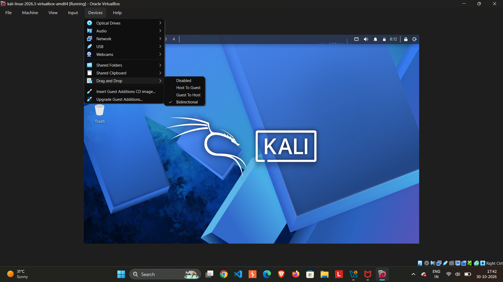
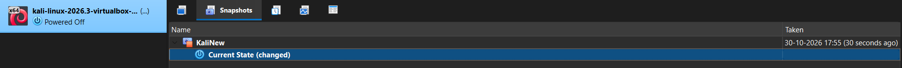

# Cybersecurity Lab Environment Setup | NetworkWalks — Week 1 (PM1)

## Project Overview

This project documents the setup of an isolated cybersecurity practice lab using **Oracle VirtualBox** and **Kali Linux** as part of the NetworkWalks Cybersecurity Internship, Week 1 — Project Module 1 (WK1-PM1).

The goal is to establish a virtual lab with a custom NAT Network, a manually configured Kali Linux IPv4 address, guest integration settings, and Internet connectivity suitable for authorized cybersecurity training.

> **Scope:** This lab is for learning and testing only on systems I own or have permission to use.

## Lab Environment

| Component | Configuration |
|---|---|
| Host operating system | Windows 11 |
| Hypervisor | Oracle VirtualBox |
| Guest operating system | Kali Linux 2026.3 (VirtualBox AMD64 image) |
| Guest RAM | 4096 MB (after performance troubleshooting) |
| Virtual CPUs | 2 |
| Network attachment | NAT Network (`NatNetwork`) |
| NAT Network prefix | `10.0.0.0/24` |
| Guest IPv4 configuration | Manual: `10.0.0.2/24` |
| Gateway | `10.0.0.1` |
| DNS server | `10.0.0.1` |
| Shared Clipboard | Bidirectional |
| Drag and Drop | Bidirectional |

## Network Architecture

```text
Windows 11 host
    |
Oracle VirtualBox
    |
NAT Network: 10.0.0.0/24
    |-- VirtualBox gateway: 10.0.0.1
    `-- Kali Linux VM: 10.0.0.2/24
```

The NAT Network gives the guest a private lab subnet while allowing outbound Internet access through the host's connection. Additional deliberately vulnerable or test VMs can be attached to this network for future authorized lab exercises.

## Implementation Steps

### 1. Set up VirtualBox and Kali Linux

Installed Oracle VirtualBox, imported the Kali Linux VirtualBox image, and booted the VM. The running Kali desktop is shown below.



### 2. Configure the NAT Network

Created a NAT Network named `NatNetwork` using the IPv4 prefix `10.0.0.0/24`. In the VM's Network settings, enabled Adapter 1, selected **NAT Network**, chose `NatNetwork`, and ensured that the virtual cable was connected.





### 3. Configure Kali's static IPv4 address

In Kali's NetworkManager graphical settings, selected the wired connection and configured:

- **Method:** Manual
- **IPv4 address:** `10.0.0.2`
- **Prefix length:** `24`
- **Gateway:** `10.0.0.1`
- **DNS:** `10.0.0.1`



### 4. Enable guest integration features

Enabled bidirectional shared clipboard and drag-and-drop from VirtualBox's **Devices** menu.





### 5. Create a VM snapshot

Created a VirtualBox snapshot named `KaliNew` as a recovery point for the virtual lab.



### 6. Verify network connectivity

Used the following commands inside Kali Linux:

```bash
ip -4 addr
ip route
ping -c 4 10.0.0.1
ping -c 4 8.8.8.8
ping -c 4 google.com
```

After troubleshooting, the gateway, external IP, and domain-name ping tests each returned **4/4 replies (0% packet loss)**, confirming gateway reachability, outbound connectivity, and working DNS resolution at that time.

**Evidence to add before submission:** a fresh terminal screenshot showing `ip -4 addr`, route information, and the successful pings, ideally after a VM restart.

### 7. Shared folder — verification pending

**To complete before submitting:** Configure the Windows Downloads folder as a VirtualBox shared folder, confirm it is accessible in Kali, and add a screenshot to `screenshots/`. The internship's Week 1 project requires host Downloads sharing; it is not shown in the current screenshots.

## Troubleshooting: Network stuck during startup

**Problem:** After a VM restart, the wired connection showed `connecting (getting IP configuration)` and the `eth0` interface initially had no IPv4 address.

**Diagnosis:** Checked the network interface and connection profile using:

```bash
nmcli device status
ip -4 addr
nmcli connection show
```

**Change applied:** Followed the NetworkWalks Week 1 troubleshooting guidance to disable IPv4 duplicate-address-detection waiting in the existing NetworkManager connection profile:

```bash
sudo nmcli connection modify "Wired connection 1" ipv4.dad-timeout 0
```

**Outcome:** Following this configuration change, tests of `10.0.0.1`, `8.8.8.8`, and `google.com` all succeeded (four replies each, no packet loss). This is an observed recovery; the exact root cause was not conclusively established. The saved configuration can be checked using:

```bash
nmcli -g ipv4.dad-timeout connection show "Wired connection 1"
```

**Additional display observation:** A white desktop after login was resolved by restoring the desired wallpaper; it was not a Linux boot failure.

## Key Learnings

- Using VirtualBox NAT Networks for a private virtual lab.
- Assigning a manual IPv4 address and default gateway in Kali Linux.
- Testing gateway connectivity, Internet access, and DNS separately.
- Investigating Linux networking with `nmcli` and `ip`.
- Creating VM snapshots and configuring host–guest integration.
- Recording both successful setup steps and troubleshooting evidence.

## Submission Checklist

- [x] VirtualBox and Kali Linux set up
- [x] NAT Network configured
- [x] Manual IP settings documented
- [x] Clipboard and drag-and-drop options enabled
- [x] VM snapshot created
- [x] Successful Internet ping tests recorded in terminal output
- [ ] Add terminal verification screenshot and confirm static IP after restart
- [ ] Configure and document shared host Downloads folder
- [ ] Publish GitHub repository and LinkedIn post
- [ ] Submit both links through the NetworkWalks submission form

## References

- NetworkWalks Cybersecurity Internship — Week 1, Project Module 1 task instructions (provided to interns)
- [VirtualBox Downloads](https://www.virtualbox.org/wiki/Downloads)
- [Kali Linux Downloads](https://www.kali.org/get-kali/)

---

*Documented from my own lab setup and troubleshooting as part of the NetworkWalks Cybersecurity Internship.*
