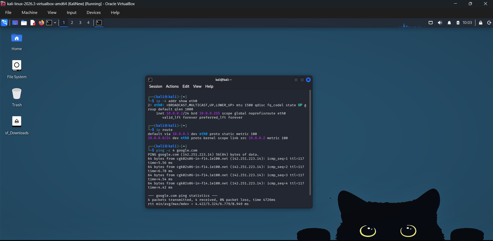
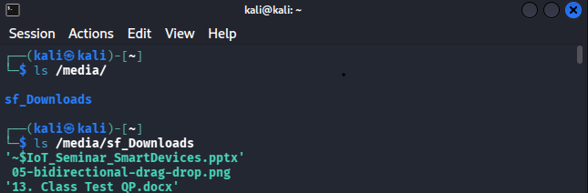

# Cybersecurity Lab Environment Setup | NetworkWalks - Week 1 (PM1)

## Project Overview

This project focuses on setting up a virtual cybersecurity testing lab using **Oracle VirtualBox** and **Kali Linux** as part of the **NetworkWalks Cybersecurity Internship - Week 1, Project Module 1 (WK1-PM1)**.

The objective is to build a functional cybersecurity practice environment by configuring virtual networking, static IP addressing, host-guest integration, shared folders, and Internet connectivity.

The lab provides a foundation for future cybersecurity exercises, network analysis, and authorized security testing.

> **Scope:** This environment is intended for educational purposes and security testing on systems I own or have explicit permission to use.

---

## 1. Lab Environment

| Component | Configuration |
|---|---|
| Host Operating System | Windows 11 |
| Virtualization Platform | Oracle VirtualBox |
| Guest Operating System | Kali Linux 2026.3 |
| Guest RAM | 4096 MB |
| Virtual CPUs | 2 |
| Graphics Controller | VMSVGA |
| Video Memory | 128 MB |
| Network Type | NAT Network |
| NAT Network Name | `NatNetwork` |
| Network Subnet | `10.0.0.0/24` |
| Kali Linux IP Address | `10.0.0.2/24` |
| Default Gateway | `10.0.0.1` |
| DNS Server | `10.0.0.1` |
| Shared Clipboard | Bidirectional |
| Drag and Drop | Bidirectional |
| Shared Folder | Windows Downloads |
| Shared Folder Mount Point | `/media/sf_Downloads` |

---

## 2. Network Architecture

The lab uses a custom NAT Network to provide a private virtual network with outbound Internet connectivity.

```text
Windows 11 Host
       |
Oracle VirtualBox
       |
NAT Network (10.0.0.0/24)
       |
       |-- Gateway: 10.0.0.1
       |
       |-- Kali Linux VM: 10.0.0.2/24
```

The NAT Network allows Kali Linux to communicate within the virtual lab while accessing the Internet through the host system.

Additional virtual machines can be added to this network for future authorized cybersecurity exercises.

---

## 3. Implementation Steps

### Step 1 - Install VirtualBox and Kali Linux

Installed Oracle VirtualBox and imported the Kali Linux VirtualBox AMD64 image.

Configured the virtual machine with the following resources:

- Base Memory: 4096 MB
- Processors: 2 CPUs
- Graphics Controller: VMSVGA
- Video Memory: 128 MB
- 3D Acceleration: Disabled

Successfully launched Kali Linux and accessed the desktop environment.

**Screenshot:**


### Step 2 - Configure NAT Network

Created a custom NAT Network in VirtualBox.

**Network Configuration:**

- Network Name: `NatNetwork`
- IPv4 Prefix: `10.0.0.0/24`
- Network Adapter: Adapter 1
- Attached To: NAT Network
- Cable Connected: Enabled

Assigned the created NAT Network to the Kali Linux virtual machine.

**Screenshots:**


### Step 3 - Configure Static IPv4 Address

Configured Kali Linux with a manual IPv4 address through NetworkManager.

**IP Configuration:**

- IPv4 Method: Manual
- IP Address: `10.0.0.2`
- Prefix Length: `24`
- Default Gateway: `10.0.0.1`
- DNS Server: `10.0.0.1`

This configuration assigns Kali Linux a specific address within the virtual lab network.

**Screenshot:**


### Step 4 - Enable Shared Clipboard and Drag-and-Drop

Enabled the VirtualBox guest integration features to improve interaction between Windows and Kali Linux.

**Settings:**

- Shared Clipboard: Bidirectional
- Drag and Drop: Bidirectional

These settings support copying text and transferring supported content between the host and guest operating systems.

**Screenshots:**


### Step 5 - Create Virtual Machine Snapshot

Created a VirtualBox snapshot named `KaliNew`.

A snapshot provides a recovery point that can be used to restore the virtual machine to an earlier state if configuration changes or future experiments cause issues.

**Screenshot:**


### Step 6 - Verify Network Connectivity

Verified the IP configuration, default gateway, Internet connectivity, and DNS resolution using Linux networking commands.

**Commands Used:**

```bash
ip -4 addr show eth0
ip route
ping -c 4 10.0.0.1
ping -c 4 8.8.8.8
ping -c 4 google.com
```

**Verification Results:**

| Test | Result |
|---|---|
| Static IPv4 Configuration | `10.0.0.2/24` configured |
| Default Gateway | `10.0.0.1` |
| Gateway Connectivity | Successful |
| Internet Connectivity | Successful |
| DNS Resolution | Successful |
| Recorded Ping Tests | 0% packet loss |

The successful ping tests confirmed connectivity to the VirtualBox NAT gateway, an external Internet address, and a domain name.

**Screenshot:**



### Step 7 - Configure Shared Folder

Configured the Windows Downloads folder as a permanent shared folder in VirtualBox.

This allows files from the Windows host to be accessed within Kali Linux.

**Shared Folder Settings:**

- Host Folder: Windows Downloads
- Auto-mount: Enabled
- Make Permanent: Enabled
- Read-only: Disabled
- Guest Mount Point: `/media/sf_Downloads`

**Verification Commands:**

```bash
ls /media/
ls /media/sf_Downloads
```

**Result:**

The shared folder was successfully mounted inside Kali Linux.

The verification commands displayed the shared folder and listed the files stored in the Windows Downloads directory, confirming successful access between the host and guest operating systems.

**Screenshot:**



---

## 4. Troubleshooting Experience

During the lab setup, I encountered several issues and resolved them through configuration checks and troubleshooting.

### Issue 1 - Network Disconnection After Restart

**Problem:**

After shutting down and restarting Kali Linux, the Ethernet connection failed to establish properly.

NetworkManager displayed:

```text
eth0 ethernet connecting (getting IP configuration)
```

The `eth0` interface initially did not have an IPv4 address, preventing Internet access.

**Troubleshooting:**

Checked the Ethernet interface, IP configuration, and NetworkManager connection profile using:

```bash
nmcli device status
ip -4 addr
nmcli connection show
```

Following the NetworkWalks Week 1 troubleshooting guidance, modified the existing NetworkManager connection:

```bash
sudo nmcli connection modify "Wired connection 1" ipv4.dad-timeout 0
```

This command disables IPv4 Duplicate Address Detection for the specified connection profile.

**Result:**

Following the configuration change, network connectivity was restored.

Verified connectivity using:

```bash
ping -c 4 10.0.0.1
ping -c 4 8.8.8.8
ping -c 4 google.com
```

All three ping tests succeeded with 0% packet loss.

Although the connection recovered after the modification, the exact root cause was not conclusively established.

**Learning:**

Gained experience diagnosing network connectivity problems using Linux terminal commands and modifying NetworkManager connection settings.

### Issue 2 - White Desktop Background After Restart

**Problem:**

After restarting Kali Linux, the desktop appeared with a white background.

**Solution:**

Verified that the operating system had booted correctly and that the desktop interface was accessible.

Restored the preferred desktop wallpaper.

**Result:**

The desktop appearance returned to normal.

### Issue 3 - Unable to Save Shared Folder Settings

**Problem:**

VirtualBox displayed an error while saving the shared folder configuration when Kali Linux was running.

**Solution:**

1. Shut down the Kali Linux virtual machine.
2. Opened VirtualBox Manager.
3. Navigated to Settings - Shared Folders.
4. Added the Windows Downloads folder.
5. Enabled Auto-mount and Make Permanent.
6. Saved the configuration successfully.

**Result:**

The shared folder was configured successfully.

Verified its accessibility inside Kali Linux using:

```bash
ls /media/sf_Downloads
```

The command successfully listed the files from the Windows Downloads folder.

---

## 5. Key Learnings

Through this project, I gained practical experience in:

- Installing and configuring Kali Linux in Oracle VirtualBox.
- Creating and managing NAT Networks for virtual lab environments.
- Configuring static IPv4 addresses, gateways, and DNS servers.
- Testing network connectivity using Linux commands.
- Troubleshooting NetworkManager configuration issues.
- Understanding IPv4 Duplicate Address Detection.
- Configuring bidirectional shared clipboard and drag-and-drop.
- Creating virtual machine snapshots for recovery.
- Establishing shared folders between Windows and Kali Linux.
- Documenting lab configurations, troubleshooting procedures, and verification results.

This project helped strengthen my understanding of virtualization, Linux networking, and practical cybersecurity lab management.

---

## 6. References

- NetworkWalks Cybersecurity Internship - Week 1, Project Module 1 (WK1-PM1)
- [Oracle VirtualBox Official Website](https://www.virtualbox.org/)
- [Kali Linux Official Website](https://www.kali.org/)
- [Kali Linux Downloads](https://www.kali.org/get-kali/)

---

**Internship:** NetworkWalks Cybersecurity Internship

**Batch:** B084

**Project:** Week 1 - Cybersecurity Lab Environment Setup (WK1-PM1)

*This project was completed and documented as part of my practical learning experience during the NetworkWalks Cybersecurity Internship.*
